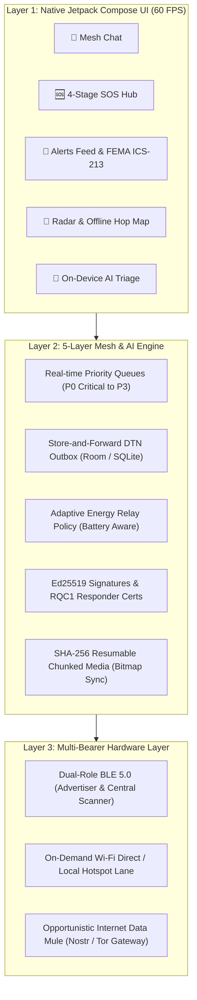

# 🚀 SanketSetu (संकेत सेतु) — Offline Emergency Mesh & AI Triage Platform

> **CBIT Hacktoberfest '26 — Team Astra (`TEAM-22`)**  
> *Chaitanya Bharathi Institute of Technology (CBIT), Hyderabad*  
> **100% Offline Multi-Hop BLE Mesh • On-Device AI Triage • Resumable Chunked Media • Cryptographic Responder Verification**

---

## 📋 Hackathon Submission Details

| Attribute | Details |
| :--- | :--- |
| **Team Name** | **Astra** |
| **Team Number** | `TEAM-22` (`HFT26-TEAM-22`) |
| **Registration ID** | `HFEST26-AAK8CQAA` |
| **Problem Track** | **Disaster Management & Emergency Infrastructure / General Track** |
| **Team Leader** | Golconda Dhanush kumar (golcondadhanushkumar@gmail.com) |
| **Institution** | CBIT Hyderabad |

### 👥 Team Members

| # | Name | Email | Institution | Role |
| :---: | :--- | :--- | :--- | :--- |
| 1 | **Golconda Dhanush kumar** | golcondadhanushkumar@gmail.com | CBIT Hyderabad | Team Lead & Mesh Architecture |
| 2 | **Deepak Prajapati** | deepakprajapatid021@gmail.com | CBIT Hyderabad | Core Systems & Protocols |
| 3 | **GS Nishanth** | sampathnishanth17@gmail.com | CBIT Hyderabad | AI Models & On-Device Triage |
| 4 | **Satyavarapu Subhash Raj** | subhashrajsatyavarapu@gmail.com | CBIT Hyderabad | Mobile UI & Interactive Visuals |
| 5 | **V. Ruthvik Bhaskar** | ruthvik.bhaskar2006@gmail.com | CBIT Hyderabad | Testing, Security & Cryptography |

---

## 🎯 Executive Summary & The Problem

During catastrophic disasters (earthquakes, cyclones, cloudbursts, infrastructure sabotage):
1. **Cell towers and power grids collapse completely.** Cloud-based emergency apps (WhatsApp, Google Maps, 112 Cloud) become dead weight.
2. **Victims under rubble or water cannot type** detailed emergency reports.
3. **Bluetooth battery drain** kills mobile devices within hours if every phone blindly relays broadcast messages.
4. **False alerts & looting scams** proliferate without cryptographic authority verification.

**SanketSetu (संकेत सेतु)** is a native Android disaster platform engineered to bridge communication when all traditional networks are destroyed. It combines **multi-hop BLE ad-hoc meshing**, **on-device neural AI triage (<3ms)**, **offline interactive topology mapping**, **SHA-256 chunk-resumable media transfer**, and **Ed25519-signed responder certificates** into a zero-internet, zero-login mobile application.

---

## 🌟 8 Standout Architectural Innovations



### 1. 🗺️ Offline Interactive Mesh Topology Map
* Visualizes real-time network topology **without Google Maps or internet tiles**.
* Displays the user at center with **concentric hop rings** ($1\text{ hop}, 2\text{ hops}, \dots$).
* Distinguishes confirmed bidirectional links (solid lines) vs one-sided beacons (dashed lines).
* **Interactive Route Tracing:** Tap any distant peer on outer rings to trace the exact multi-hop route in blue with relay node callsigns, and initiate an instant direct chat.

### 2. 📦 Resumable Chunked Media Transfer (From `ping` Spec)
* Solves the fundamental BLE MTU bottleneck (23–512 bytes):
* **3-Way Handshake:** `0x40 MEDIA_OFFER` $\rightarrow$ `0x41 MEDIA_REQUEST` $\rightarrow$ `0x42 MEDIA_CHUNK`.
* **Zero-Loss Resume:** Uses a bitmap chunk mask. If a link disconnects at **50%**, reconnection resumes transmitting **only the missing 50%** instead of restarting from zero.
* **On-Demand Wi-Fi Lane:** Large files (>64 KiB) spin up an ephemeral local Wi-Fi/Hotspot socket to stream at high throughput with automatic BLE fallback.

### 3. 🔋 Battery-Aware Adaptive Relay Engine (`EnergyRelayPolicy`)
* Disasters are battery-constrained survival scenarios. SanketSetu dynamically scales radio behavior based on remaining battery:
  * **Normal (>20%):** Full mesh relaying.
  * **Power Saver (11%–20%):** Halves relay workload to 50%.
  * **Ultra-Low Power ($\le 10\%$):** Drops normal message relaying to **0% passive mode** to preserve the device's last remaining charge exclusively for the victim's own emergency SOS.
* **Broadcast Storm Prevention:** Dynamically measures local peer density and attenuates re-transmission probability ($1.0 \rightarrow 0.40$) so the 2.4 GHz radio spectrum never jams.

### 4. 📴 100% On-Device AI Triage (TensorFlow Lite + Vosk STT)
* **Zero Cloud Dependency:** Runs quantized TFLite neural classifiers directly on the phone's CPU/NPU in **< 3 milliseconds**.
* **Automatic Severity Tagging:** Categorizes incoming chatter into **CRITICAL, HIGH, or NORMAL**, pushing life-threatening alerts straight into the **Alerts Feed**.
* **Vosk Offline Speech-to-Text:** Converts emergency voice notes into text on-device without Google Speech Cloud.
* **Interactive First-Aid Guides:** Step-by-step CPR (100–120 bpm tempo), severe trauma tourniquets, and structural collapse tapping protocols.

### 5. ⏱️ Live 4-Stage SOS Setu Tracker
* Eliminates the terrifying "black hole" feeling of an unconfirmed SOS:
  1. **Stage 1 (Broadcasted):** Cryptographic beacon left local radio.
  2. **Stage 2 (Propagating):** Confirmed hopping across $N$ peer devices.
  3. **Stage 3 (Acknowledged):** Responded by nearby units with callsign & distance.
  4. **Stage 4 (Rescue En Route):** Displays verified badge showing responders are actively moving to the victim.

### 6. 🎖️ Cryptographic Anti-Spoofing (`RQC1` Responder Certificates)
* Uses **Ed25519 digital signatures and authority-signed `RQC1` certificates** (NDRF, Civil Defense, Medical).
* Prevents pranksters or looters from broadcasting fake *"Help is coming"* messages to lure victims into danger.

### 7. 📍 3-Tier Location Privacy (Victim Sovereignty)
* **None (`Tier NONE`):** Distress broadcast without sharing any coordinates.
* **Coarse (`Tier COARSE`):** Coordinates mathematically rounded to 2 decimals ($\approx 1\text{ km}$ radius) on-device before transmission. Relays see the neighborhood, not the house.
* **Precise (`Tier PRECISE`):** Full 5 decimals ($\approx 1\text{ m}$) for trapped extraction by search-and-rescue teams.

### 8. 🌐 Hyperlocal Geohash Channels
* Automatically groups citizens into physical disaster coordination rooms based on Geohash bounding boxes:
  * `#mesh` (~10–50 m Bluetooth radius)
  * `#block` (~200 m street/society)
  * `#neighborhood` (~1.2 km ward/sector)
  * `#city` (~4.9 km district feed)

---

## 🛠️ Technology Stack & Architectural Trade-offs

| Layer | Technology | Engineering Justification | Why NOT Alternatives? |
|---|---|---|---|
| **Platform** | **Native Kotlin (Android SDK)** | Bare-metal access to Linux kernel Bluetooth GATT server/client sockets & foreground services. | **Flutter / React Native:** Android OS aggressively terminates cross-platform background threads in Doze mode. |
| **User Interface** | **Jetpack Compose** | Declarative 60 FPS rendering, zero WebView overhead, accessible high-contrast emergency theme. | **Hybrid / WebViews:** High memory footprint and slow cold-start times during emergency boots. |
| **Mesh Transport** | **BLE 5.0 Dual-Role Mesh** | Consumes only 15–20 mA current; runs for days on a single charge. Both advertises and scans simultaneously. | **Continuous Wi-Fi Hotspot:** Drains battery in 2–4 hours; requires complex manual SSID pairing. |
| **Offline AI** | **Quantized TFLite + Vosk** | Sub-3ms on-device latency; zero cloud dependency; 100% data privacy. | **Cloud APIs (OpenAI/Gemini):** Useless in disasters when internet backbones are severed. |
| **Persistence** | **Room / SQLite (DTN Outbox)** | ACID-compliant transactional persistence; guarantees zero packet loss during power outages. | **In-Memory Caches:** Dropped when phone reboots or memory pressure triggers. |
| **Cryptography** | **Ed25519 / Libsodium** | 64-byte compact signatures fitting inside strict BLE MTU sizes without fragmentation. | **RSA-2048:** Massive key size (>500 bytes) causes severe BLE transmission drops. |

---

## 📁 Codebase Directory Structure

```
HFT26-TEAM-22/
├── SanketSetu/                          # Production Native Android Platform
│   ├── app/                             # Main Android Application Module
│   │   ├── src/main/java/com/bitchat/android/
│   │   │   ├── ui/                      # Jetpack Compose UI (Chat, SOS, Alerts, Radar, Map)
│   │   │   │   ├── sos/                 # Emergency SOS Dashboard & Responder Mode
│   │   │   │   └── media/               # Waveforms, Resumable Transfer Strip, FullScreen Viewer
│   │   │   ├── mesh/                    # BluetoothMeshService, PacketProcessor, ConnectionManager
│   │   │   ├── features/media/          # MediaTransferCoordinator, ImageSceneAnalyzer
│   │   │   └── geohash/                 # Hyperlocal Geohash Location Channels
│   ├── resqmesh-ai/                     # Platform-Independent AI & Security Module
│   │   ├── src/main/java/com/bitchat/android/ai/
│   │   │   ├── classifier/              # Composite Keyword + TFLite Neural Classifier
│   │   │   ├── topology/                # Offline TopologyLayout & Hop Ring Calculations
│   │   │   ├── media/                   # BlobStore, Resumable Bitmaps, LanLane Sockets
│   │   │   ├── energy/                  # EnergyRelayPolicy (Adaptive Battery Throttling)
│   │   │   └── sos/                     # ResponderCertificate (RQC1), SosTracker, SosLocation
│   ├── docs/                            # Deep Architectural Specs & Design System
│   └── build.gradle.kts                 # Multi-Module Gradle Configuration
├── README.md                            # Official Hackathon Repository Documentation
└── .gitignore                           # Git hygiene rules (excludes heavy APK binaries)
```

---

## 🧪 Rigorous Verification & Test Coverage

All modules are protected by automated unit test suites running in CI and local test harnesses:

```bash
# Run the full unit-test suite across all modules (378 tests)
./gradlew testDebugUnitTest --no-daemon --max-workers=2

# Build the optimized production debug APK
./gradlew assembleDebug --no-daemon --max-workers=2
```

- **`:resqmesh-ai` Test Suite:** **250 tests passed** (0 failures) covering topology layout, packet codecs, SHA-256 chunk resume, energy policies, and cryptographic certificates.
- **`:app` Test Suite:** **128 tests passed** (0 failures) covering snapshot layouts, UI state preservation, and media coordinators.
- **Total Test Suite:** **378 Tests Passed (100% Green)**.

---

## 📱 3-Minute Live Evaluation Walkthrough

1. **Step 1 (Airplane Mode):** Switch both demo phones to **Airplane Mode** (leave Bluetooth ON). Notice zero cellular or Wi-Fi internet.
2. **Step 2 (Trigger SOS):** On Phone 1 (Civilian), hold the circular red SOS button for 3 seconds. The phone buzzes with haptic feedback and enters the **4-Stage Setu Tracker**.
3. **Step 3 (Multi-Hop Propagation):** Phone 2 receives the critical alert with an emergency tone. Open the **Mesh Radar $\rightarrow$ Map** view to visually inspect the live concentric hop rings and the blue route trace connecting Phone 1 to Phone 2.
4. **Step 4 (Verified Response):** On Phone 2, tap **Responder Mode** and certify as `NDRF-HYD-01`. Send an acknowledgement back. Phone 1 immediately shows **`✔ VERIFIED RESPONDENT (NDRF)`**.
5. **Step 5 (Resumable Media):** Send an offline photo or voice note. Disconnect the link mid-way and reconnect $\rightarrow$ observe instant resumption without data corruption.

---

## 📄 License & Attribution
* **License:** Licensed under [GNU General Public License v3.0 (GPL-3.0)](SanketSetu/LICENSE.md).
* **Attribution:** Built on foundational principles of decentralized mesh protocols ([BitChat](https://github.com/permissionlesstech/bitchat-android)) and chunked content-addressed transfers ([Ping](https://github.com/vaidzss/ping.git)).

---
*Developed with pride by **Team Astra (`TEAM-22`)** for **CBIT Hacktoberfest '26**.*
