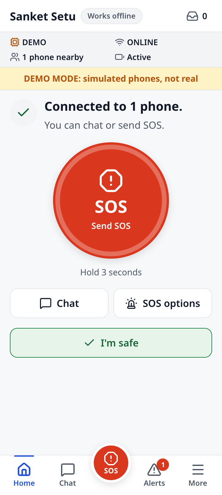
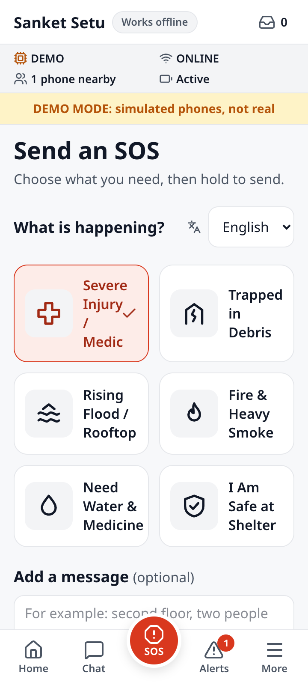
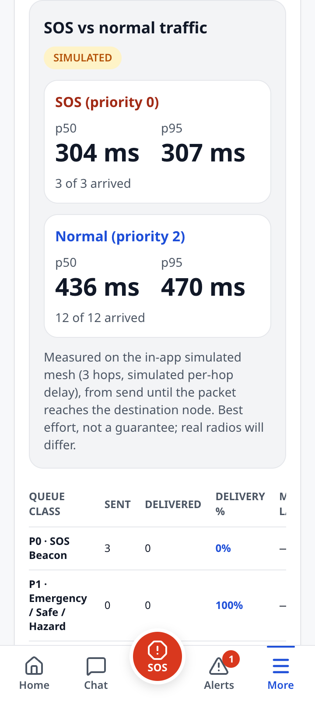
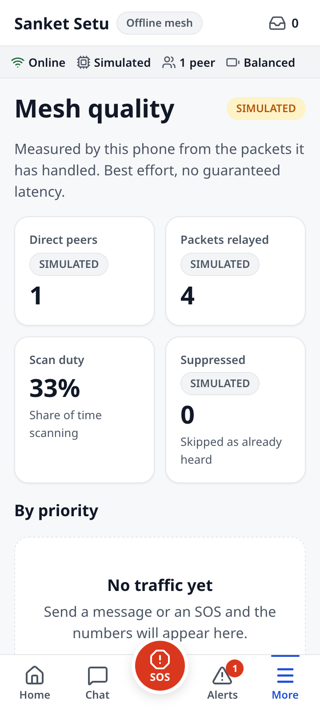
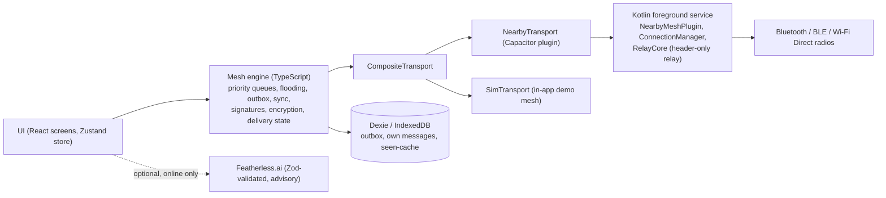

# Sanket Setu

**Offline emergency messaging and SOS over a phone-to-phone mesh.** *Setu* means bridge: when towers
and internet fail, nearby phones become the bridge. Works with no internet or cell signal.

Team Astra · CBIT Hacktoberfest '26 · HFT26-TEAM-22 · MIT license

<p>
  
  
  
  
</p>

## 1. Problem

In disasters and outages, cell towers and internet go down exactly when people most need to reach
each other. Survivors cannot tell whether an SOS was heard, and plain Bluetooth broadcast tools do
not authenticate who answers or protect exact locations. We need messaging that works with no
network, reaches people out of direct range, puts emergencies first, shows what actually happened to
each message, stays alive on a draining battery, and cannot be read or forged by bystanders.

## 2. Solution

An Android app (React + Capacitor) with an on-device mesh engine and a Kotlin foreground service
that uses Google Nearby Connections (Bluetooth + Wi-Fi Direct). There is no server. Messages and
SOS beacons are signed and encrypted, flooded across phones within range, queued when nobody is
reachable, and re-sent until delivery is confirmed. An optional online AI assistant can summarize,
translate and suggest alert order. It never blocks the app and never decides for the user.

## 3. Architecture



- `src/core/protocol/constants.ts`: every TTL, jitter, window and threshold in one file.
- `src/mesh`, `src/crypto`, `src/transport`, `src/db`: core logic. An architecture test fails the build if these import UI code.
- `plugins/nearby-mesh/android`: Kotlin plugin and foreground service.
- **Real vs Demo mode.** The app starts in **Real** mode on a phone: the only transport is the Nearby
  radio, and peers, messages, alerts and stats come only from real engine events. **Demo** mode (Settings,
  "Demo", plus the Simulator screen) is the only place simulated phones and fixtures exist, and it shows a
  permanent amber "DEMO MODE: simulated phones, not real" banner. The status strip always says `REAL RADIO` or `DEMO`.

## 4. Requirement traceability

| # | Requirement | Where | Verified how |
| --- | --- | --- | --- |
| 1 | Offline communication | No network calls in `src/mesh`, `src/crypto`, `src/transport`; AI is the only network code | Architecture test; unit tests run with no network |
| 2 | P2P over local radios | `NearbyTransport`, `NearbyMeshPlugin.kt`, `ConnectionManager.kt` | Compiles (debug APK built earlier). **Two-phone delivery UNVERIFIED** |
| 3 | Multi-hop relay | `engine.maybeRelayPacket`, `RelayCore.kt` | Tests 4, 12 (A to B to C to D, TTL expiry) on loopback/simulated transport. **Real multi-hop UNVERIFIED** |
| 4 | SOS with location if permitted | `engine.broadcastSOS`, `sealedLocation.ts` | Tests 6, 9 (none / coarse / precise sealed to responder key) |
| 5 | Priority for SOS/emergency | `priority.ts` (P0 to P3, strict order) | Tests 7, 25 |
| 6 | Delivery status | `MessageDeliveryState`, `DeliveryBridge` | Tests 4, 14 (forged ACK ignored) |
| 7 | Encryption + authentication | `crypto/*`, PIN vault | Tests 1, 2, 10, 13, 16 |
| 8 | Battery efficiency | `power.ts`, native duty-cycling in `NearbyMeshPlugin.kt` | Schedule math tested. **On-device battery effect UNVERIFIED** |
| 9 | Recovery and sync | `outbox.ts`, `sync.ts`, retry loop, Dexie restore | Tests 5, 21, 22a, 22b, 23, 24 |
| AI | Optional assistant | `src/ai/*` | Tests 19, 20 (offline falls back, never throws) |

Extras: closed-loop SOS tracker, responder certificates and sealed GPS, safety circles, signed hazard
beacons with expiry, alerts (sort, 200 m clustering, rule-based hint), SOS pictograms (EN/HI/TE/TA),
packet inspector, 4-node simulator with congestion benchmark, mesh map, Mesh Quality screen, Setu
gateway (DEMO), Rescuer Locate (EXPERIMENTAL, simulated).

## 5. Packet format

JSON envelope, at most 4096 bytes. Types: `HELLO, MSG, SOS, SOS_ACK, SAFE, HAZARD, ACK, SYNC_INV, SYNC_REQ`.

```json
{
  "v": 1, "id": "<32 hex chars (16 random bytes)>", "type": "MSG", "prio": 2,
  "ttl": 8, "hops": 0,
  "src": "<8 hex node id>", "srcSignPub": "<base64 Ed25519>", "srcBoxPub": "<base64 X25519>",
  "dst": "<node id or BROADCAST>", "ts": 1760000000000,
  "nonce": "<base64, 24 bytes>", "payload": "<base64 ciphertext>",
  "route": ["<relay ids, appended by relays>"], "sig": "<base64 Ed25519 detached>"
}
```

The signature covers only `v, id, type, prio, src, srcSignPub, srcBoxPub, dst, ts, nonce, payload`.
`ttl`, `hops` and `route` change at every relay, so relays never re-sign and `route` is an
**unauthenticated hint**.

## 6. Parameters

| Parameter | Value |
| --- | --- |
| TTL | 8 (SOS and SOS ACK: 12) |
| Relay jitter | 10-50 ms (SOS 0-10 ms); forward cancelled if heard from 2 or more neighbours |
| Replay window | +/- 5 minutes, plus seen-id check |
| Seen-cache | about 1 hour, capped at 4096 ids, persisted |
| Outbox backoff | 1 s doubling to a 30 s cap; retried on every peer found and at app start |
| Queues | P0 SOS, P1 emergency, P2 normal, P3 info/ACK; P3 then P2 dropped first under congestion or Saver |
| Battery modes | Balanced below 30% (10 s scan on / 20 s off), Saver below 15% (5 s on / 45 s off, SOS and emergency only), Last-Gasp SOS at 5% or less |
| Scan backoff | doubles up to 60 s with no peers, resets when a peer appears |
| Concurrent links | cap of 4, least-recently-active idle link rotated out |

## 7. Security summary

TweetNaCl only: Ed25519 signatures; X25519 + XSalsa20-Poly1305 (`nacl.box` / `nacl.secretbox`).
Direct messages are end-to-end encrypted. SOS broadcasts use a shared channel key (it only deters
casual snooping). Precise SOS location is sealed to the responder group key with an ephemeral
`nacl.box`; everyone else sees about 1 km. First-contact keys are trusted on first use with a
key-change warning, or verified by QR. Responder acknowledgements count only with a valid authority
certificate (the authority in this build is a **DEMO** authority).

Private keys are encrypted at rest. With a PIN, the vault key is derived from it and kept only in
memory, so the keys cannot be opened without the PIN. Without a PIN (skippable, with a warning) a
random key stored on the device is used, which only protects against accidental exposure. Full threat
model and limits: [docs/SECURITY.md](docs/SECURITY.md).

## 8. Setup

```bash
npm install
npm run dev                 # browser build with the simulated mesh, http://localhost:3000
npm run typecheck && npm test && npm run build
npm run contrast            # WCAG AA check of every colour pair, both themes
```

### Android

Needs JDK 21 (Capacitor Android 8 compiles Java 21; JDK 17 and JDK 25+ both fail), the Android SDK,
and Google Play Services on the phone (Android 8.0+, API 26).

```bash
npm run build && npx cap sync android
cd android
export JAVA_HOME="$(brew --prefix openjdk@21)" ANDROID_HOME="$HOME/Library/Android/sdk"
./gradlew assembleDebug     # android/app/build/outputs/apk/debug/app-debug.apk
```

Install on two phones and capture logs (replace the serials from `adb devices`):

```bash
adb devices
adb -s <serialA> install -r app/build/outputs/apk/debug/app-debug.apk
adb -s <serialB> install -r app/build/outputs/apk/debug/app-debug.apk
adb -s <serialA> logcat -c && adb -s <serialA> logcat | grep -i SanketMesh   # one terminal per phone
```

Open `SanketSetu/android` (not the repo root) in Android Studio and decline any Gradle upgrade prompt:
the project is pinned to Gradle 8.14.3 and AGP 8.13. Real mesh behaviour needs two or more physical
phones; follow [docs/HARDWARE_TEST_CHECKLIST.md](docs/HARDWARE_TEST_CHECKLIST.md) (start with the
10-minute two-phone test).

### Static demo site

`vercel.json` and `netlify.toml` publish `dist/` (the simulated mesh) as a static site.

## 9. Tests

`npm test` runs 38 deterministic tests with `node:test` (no network, no real clock dependence beyond
short waits): signatures, tamper and replay rejection, forged ACKs, TTL, dedup, jitter and
suppression, priority under flood, rate limiting, 4-node multi-hop, link break and sync, outbox retry
and restore, sealed GPS, responder certificates, identity vault, geo clustering, benchmark statistics,
offline AI behaviour, and the core-never-imports-UI architecture rule.

## 10. Performance

Initial load (production build): main chunk 468 kB (149 kB gzip) plus a 40 kB stylesheet; screens
load on demand (3 to 23 kB each, AI assistant 97 kB). The optional 3D visual (917 kB) loads only
when switched on in Settings. Before the redesign the Home route alone shipped about 1.7 MB.
Details in [docs/UI_PERFORMANCE.md](docs/UI_PERFORMANCE.md). Frame rate and battery were **not**
measured on a phone; judge them on a release build, not an emulator.

## 11. Known limitations

- **Soft real-time, best effort.** No latency guarantee. Benchmark numbers come from the simulated mesh.
- Google Nearby Connections sustains roughly 3 to 5 simultaneous links per phone (device dependent); we cap at 4.
- Battery versus connectivity is a trade-off: Balanced and Saver find peers more slowly.
- Android with Google Play Services only. No iOS.
- **The native relay forwards unverified packets.** `RelayCore.kt` only reads `id/ttl/hops` to keep relaying while the WebView is throttled; the TypeScript engine does all signature checks and decryption. A malicious nearby device can make phones spend radio and battery on junk, bounded by TTL and the dedup cache.
- **Signature verification runs on the main thread**, not a Web Worker. Under a packet flood this can cause UI jank.
- The PIN KDF is an iterated SHA-512 stretch, not a vetted KDF; Android Keystore wrapping is not wired in. Without a PIN, the key sits beside its ciphertext.
- Only this phone's own messages, SOS alerts and outbox are restored after a restart; received message history is not.
- RSSI and link quality for real peers are constant placeholders (Nearby Connections does not expose them), so Rescuer Locate exists only in Demo mode, as a simulated prototype.
- The Responder Authority and its group key are a built-in **DEMO** authority; there is no revocation or key rotation.
- Everything about the real radio path (permissions, advertising, discovery, connection, notifications, vibration) is **UNVERIFIED on hardware**: it is covered by integration tests against a fake native bridge and by a successful `assembleDebug`, not by a two-phone run. See the checklist.

## 12. Screenshots

Light theme, 360x800, from `node scripts/capture-screenshots.mjs` (needs the preview server and Chrome):
[home](docs/screenshots/home.png), [SOS](docs/screenshots/sos.png), [chat](docs/screenshots/chat.png),
[alerts](docs/screenshots/alerts.png), [circles](docs/screenshots/circles.png), [map](docs/screenshots/map.png),
[mesh quality](docs/screenshots/mesh-quality.png), [benchmark](docs/screenshots/simulator-benchmark.png),
[settings](docs/screenshots/settings.png), [splash](docs/screenshots/splash.png), [onboarding](docs/screenshots/onboarding-1.png).
Screenshots are browser captures of the simulated mesh, not real-radio sessions.

## 13. Team and license

Team Astra: Golconda Dhanush Kumar (lead), Deepak Prajapati, GS Nishanth, Satyavarapu Subhash Raj,
V. Ruthvik Bhaskar. MIT, see [LICENSE](LICENSE). Mesh engine, crypto, plugin and UI were written for
this hackathon; fonts are Noto Sans (SIL OFL) via `@fontsource`. The AI assistant is optional and uses
Featherless.ai when you provide a key (`VITE_FEATHERLESS_API_KEY`; a key in a client bundle can be
extracted, so use a throwaway key).
