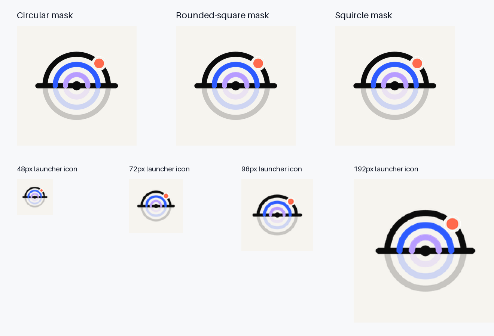

# Android launcher icon

The adaptive launcher icon uses `logo/icon-foreground.svg` as the artwork source. Its
transparent foreground is fitted proportionally to 69% of the 108dp canvas width and centered
on both axes. The adaptive background is the brand off-white `#F6F4EF`. The adaptive-icon XML
uses separate background and foreground resources; density-specific PNGs also provide legacy
launcher fallbacks.

The preview uses raster mask approximations for comparison. Check the installed app on target
launchers as part of device verification because launcher mask shapes vary by device.
